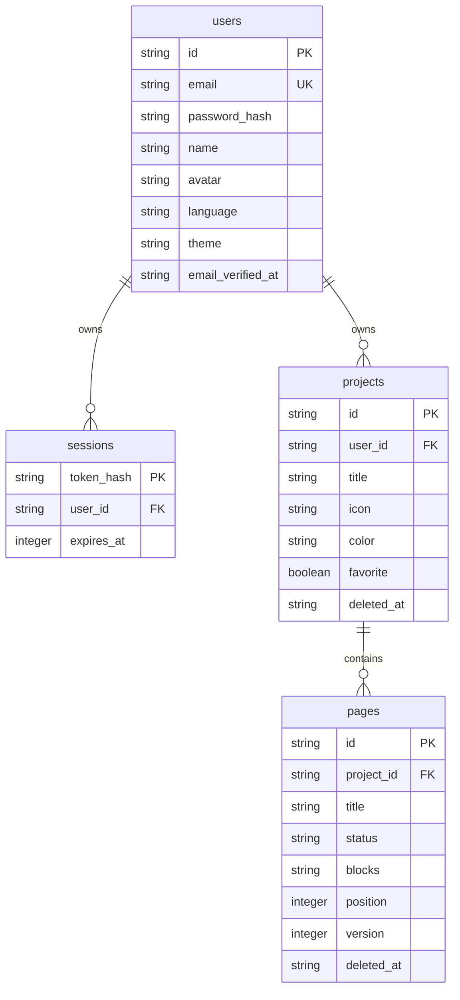

# Arquitectura inicial

## Objetivo

Un monolito pequeño y fácil de ejecutar: ReactJS presenta el espacio personal y Node.js valida y persiste las operaciones. SQLite se conserva para uso local; PostgreSQL es obligatorio en producción. La interfaz y la API comparten origen para simplificar sesiones y despliegue. Render sirve ambos desde la misma dirección y Neon conserva los datos fuera del sistema de archivos temporal del servidor.

## Modelo

Cada página almacena bloques estructurados como JSON validado por Zod. Los bloques tienen ID propio y un tipo: `text`, `table`, `report` o `link`. Las filas de una tabla tienen ID, título, estado, prioridad y URL. El texto enriquecido utiliza JSON de Tiptap, sin insertar HTML arbitrario.

Los estados internos son `todo`, `progress`, `blocked` y `done`. Son independientes de las traducciones de interfaz.

## Cálculo del avance

1. Se consideran las páginas activas del proyecto.
2. Si alguna contiene tareas, se cuentan las tareas de todas las tablas activas. Una tarea sin título también cuenta hasta que se elimine.
3. Si no hay tareas, se utilizan los estados de las páginas.
4. Avance = unidades completadas / unidades totales, redondeado a un porcentaje entero.
5. Un bloqueo tiene prioridad; después se consideran completado, en curso y pendiente.

Un proyecto vacío está pendiente y tiene 0 % de avance. La API calcula los resúmenes al consultarlos. El editor actualiza la vista del proyecto después de guardar. Al volver al dashboard se consulta el resumen actual; no hay actualización en tiempo real entre dispositivos.

Los contadores por estado se guardan bajo `counts` para distinguir `counts.progress` del porcentaje `progress`.

## Sesiones y aislamiento

- Identificadores UUID y consultas SQL parametrizadas.
- Sesiones opacas aleatorias; solo su hash se persiste.
- Cookie HttpOnly y SameSite Strict; Secure en producción.
- scrypt asíncrono con salt de 16 bytes y hash de 64 bytes.
- Límite de intentos en registro e inicio de sesión.
- Escrituras requieren la cabecera `X-Nodo-Client` y un origen permitido cuando el navegador envía `Origin`. No se habilita CORS entre sitios.
- Las páginas se consultan mediante un JOIN con el propietario del proyecto.
- Eliminación lógica para proyectos y páginas. No hay borrado permanente en la interfaz.
- URLs limitadas a HTTP y HTTPS. Las tarjetas no solicitan recursos remotos ni incrustan documentos de terceros.
- Helmet establece cabeceras de seguridad y una política de contenido. Las respuestas de API usan `Cache-Control: no-store`.

## Guardado

El editor espera 800 ms después del último cambio. Serializa las solicitudes y sigue guardando si hay nuevas modificaciones durante una solicitud. Cada escritura debe incluir la versión que se leyó; una versión antigua devuelve HTTP 409.

Antes de cambiar de página, navegar o cerrar sesión, se intenta guardar. Si falla, la navegación dentro de la aplicación se cancela y los cambios permanecen en la ventana. El navegador advierte antes de cerrar una pestaña con cambios pendientes. No hay edición offline ni borradores persistentes: cerrar forzosamente el navegador puede perder cambios que todavía no se guardaron.

## API principal

| Recurso                                   | Operaciones                                |
| ----------------------------------------- | ------------------------------------------ |
| `/api/auth/register`, `/login`, `/logout` | Autenticación                              |
| `/api/me`                                 | Perfil y preferencias                      |
| `/api/dashboard`                          | Resumen del usuario                        |
| `/api/projects`                           | Listado con filtros y paginación; creación |
| `/api/projects/:id`                       | Consulta, edición y papelera               |
| `/api/projects/:id/duplicate`, `/restore` | Duplicación y recuperación                 |
| `/api/projects/:id/pages`                 | Creación de páginas                        |
| `/api/pages/:id`                          | Guardado con versión y papelera            |
| `/api/pages/:id/duplicate`, `/restore`    | Duplicación y recuperación                 |
| `/api/trash`                              | Papelera del usuario                       |

## Límites conocidos

Esta base no incluye colaboración, permisos compartidos, recuperación de contraseña, carga de archivos, importación de Notion, edición simultánea, OAuth ni sincronización de proveedores. La verificación de correo es obligatoria y requiere un proveedor de correo configurado. Consulta [el flujo de verificación](email-verification.md).

Los límites técnicos iniciales son 1 MB por solicitud, 100 bloques por página y 500 tareas por tabla. Las sesiones duran siete días y el límite de acceso es de 30 intentos por IP cada 15 minutos. El rate limiter usa memoria del proceso.

La capa de almacenamiento utiliza consultas asíncronas con parámetros. En SQLite, las operaciones se serializan para impedir que una solicitud interfiera en la transacción de otra. En PostgreSQL se utiliza un pool pequeño y una conexión exclusiva por transacción. Las consultas remotas validan TLS; la verificación de correo toma un bloqueo de fila por usuario. El esquema PostgreSQL registra su versión en `schema_migrations` y la inicialización utiliza un bloqueo asesor para coordinar instancias.

El esquema local usa `PRAGMA user_version = 2`. La migración desde la versión 1 añade `users.email_verified_at` y la tabla `email_verifications`, elimina las sesiones previas y conserva usuarios y proyectos. Las cuentas existentes deben verificar su correo al volver a entrar. El importador a PostgreSQL conserva el contenido, rechaza destinos con usuarios y no copia sesiones ni códigos pendientes.

## Referencias técnicas

- [Vite](https://vite.dev/guide/)
- [TailwindCSS con Vite](https://tailwindcss.com/docs/installation/using-vite)
- [SQLite de Node.js](https://nodejs.org/api/sqlite.html)
- [Extensiones de Tiptap](https://tiptap.dev/docs/editor/core-concepts/extensions)
